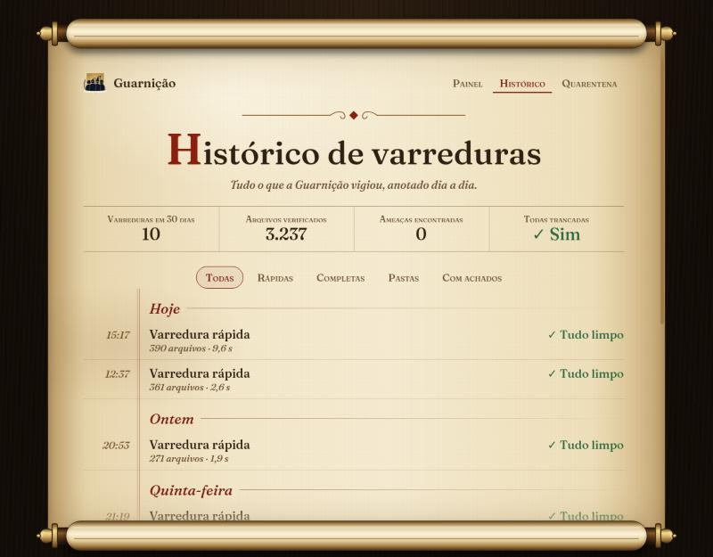
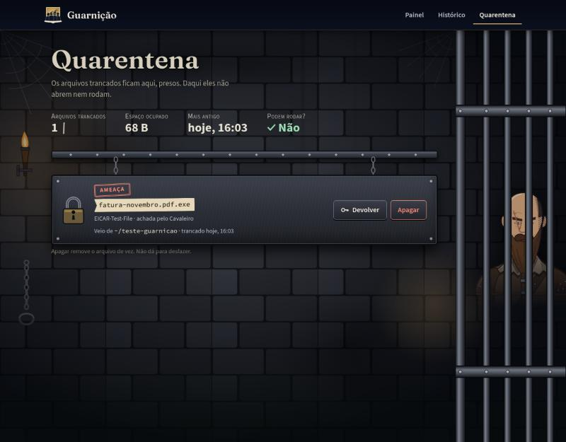

# Guarnição


Antivírus para Linux. Bloqueia ameaças antes de elas executarem, vigia os downloads
e os processos e varre o sistema com ClamAV, regras YARA e os hashes do
MalwareBazaar, atualizados de hora em hora.

Até novembro de 2026 o projeto se chamava Guardião. Quem instalou com o nome
antigo não perde nada: veja [Vindo do Guardião](#vindo-do-guardião).


## Como funciona

Depois de instalado, a Guarnição é formada por cinco serviços do systemd. Nenhum
depende de uma janela aberta.

| Serviço | O que faz | Quando roda |
|---|---|---|
| **Protetor** | Analisa cada programa no instante em que alguém tenta executá-lo e bloqueia se for uma ameaça | O tempo todo, desde o boot |
| **Monitor** | Analisa cada arquivo que termina de baixar em Downloads e avisa se algum processo agir como shell reverso ou minerador | O tempo todo, desde o login |
| **Atualizar bases** | Baixa os hashes, as regras e as assinaturas novas | De hora em hora |
| **Varredura rápida** | Confere os lugares onde malware costuma ficar: Downloads, `/tmp`, programas que iniciam sozinhos | Todo dia, por volta das 12:30 |
| **Varredura completa** | Confere o disco inteiro | Uma vez por semana, perguntando antes (veja abaixo) |

O protetor e o monitor olham o que acontece *agora*. As varreduras existem para o
que já estava no disco antes, e para arquivos que pareciam limpos e passaram a ser
reconhecidos depois de uma atualização das bases.

As varreduras agendadas nunca movem nada sozinhas: avisam com uma notificação, e
você decide no painel.

### Varreduras e jogos (ou qualquer programa pesado)

A varredura completa lê o disco inteiro e é a mais pesada. Para ela não atrapalhar
o que você estiver usando:

- **Ela pergunta antes.** Quando passa uma semana desde a última, aparece o aviso
  *"Hora da varredura completa da semana"* com dois botões: **Varrer agora** ou
  **Mais tarde**. Se você escolher *Mais tarde*, ela pergunta de novo no dia
  seguinte (no máximo uma vez por dia).
- **Ela só começa sozinha com o computador parado.** Se o teclado e o mouse
  ficarem 15 minutos sem uso e o notebook estiver no carregador, ela começa sem
  perguntar. Se você voltar a usar, ela continua, mas devagar e cedendo a vez.
- **Ela tem um teto de memória.** As varreduras agendadas (rápida e completa)
  podem usar no máximo cerca de 2,5 GB. Se o computador ficar sem memória, o
  sistema encerra a varredura primeiro, e não o seu jogo. Ela volta a ser
  oferecida depois.
- **Ela gasta pouca memória.** O disco é analisado aos poucos, em lotes, em vez
  de guardar a lista de todos os arquivos de uma vez (no teste, o processo
  principal caiu de 1,1 GB para cerca de 40 MB).

Para começar a completa da semana na hora, com as mesmas regras, use
`.venv/bin/python -m guarnicao semanal --agora`. Para ver quando cada coisa roda:
`systemctl --user list-timers 'guarnicao-*'`.

O teto de memória vale só para as varreduras **agendadas**. A que você inicia pelo
painel ou com `guarnicao varrer` roda sem teto, porque foi você quem pediu.

## Painel

```bash
.venv/bin/python -m guarnicao launcher
```

Abre o painel numa página local, desenhada como um livro de fantasia. Uma
barra no alto leva às três telas, sempre no mesmo lugar; clicar no emblema volta
ao Painel. Tudo roda no próprio computador, sem nada vindo da internet, nem as
fontes. O painel nunca roda como root e só liga serviços mostrando o comando para
você rodar.

### Os quatro guardiões

Cada camada de detecção é um personagem no alto da muralha:

| Guardião | Cuida de | O que faz |
|---|---|---|
| **O Cavaleiro** | Assinaturas | Reconhece ameaças já conhecidas: os hashes do MalwareBazaar e a base do ClamAV |
| **A Arqueira** | Regras | Mira nos padrões das regras YARA que denunciam famílias de malware |
| **O Vidente** | Sinais suspeitos | Percebe o que parece perigoso mesmo sem assinatura, e conduz a caçada de invasores escondidos |
| **O Carcereiro** | Quarentena | Tranca só o que você mandar, e devolve quando você pedir |

Durante uma varredura, quem está trabalhando acende a tocha. Quando um deles acha
algo, o retrato dele brilha e o nome da ameaça aparece embaixo.

### Painel: a muralha


O céu conta como está o computador: noite calma com lua quando está tudo limpo, e
fogo no horizonte quando há algo perigoso esperando decisão; fumaça no braseiro
da torre quando as bases estão velhas ou um serviço está desligado. No alto ficam a última
varredura, quantos arquivos foram conferidos e a idade das bases. Embaixo, os
botões (varredura rápida, completa, de uma pasta, e a caçada de invasores), o
estado dos serviços em segundo plano e as últimas varreduras.

### Histórico: o pergaminho



Cada varredura vira uma linha no pergaminho, agrupada por dia, com o tipo, a
duração, quantos arquivos e o resultado; quando algo foi achado, aparece também
qual guardião achou. Os filtros separam as rápidas, as completas, as de uma pasta e
as que tiveram achados. No pé, a Guarnição assina com um selo de cera.

### Quarentena: a cela



Os arquivos trancados ficam acorrentados atrás das grades, cada um com o motivo,
o guardião que achou, a pasta de onde veio e quando foi trancado. Daqui eles não
abrem nem rodam.
**Devolver** põe o arquivo de volta no lugar original; **Apagar** pede uma
confirmação e remove de vez.

## Detecção

Cada arquivo passa por quatro camadas:

1. **Hashes** de malware conhecido, incluindo os enviados ao [MalwareBazaar](https://bazaar.abuse.ch).
2. **[ClamAV](https://www.clamav.net/)**, com milhões de assinaturas.
3. **Regras YARA**: as do projeto e cerca de 5 mil do [YARA Forge](https://github.com/YARAHQ/yara-forge).
4. **Heurísticas**: executável disfarçado de imagem, extensão dupla, conteúdo
   embaralhado. Viram "suspeito", nunca "ameaça" sozinhas.

Arquivos `.zip`, `.tar`, `.docx` e `.jar` são abertos e analisados por dentro.

Opcionalmente, o [VirusTotal](https://www.virustotal.com) confere os downloads
novos e o que a varredura achou suspeito, com a opinião de uns 70 antivírus. Só o
hash do arquivo é enviado, nunca o arquivo.

Medido com 195 amostras reais de novembro de 2026: reconhece **99,5%** do malware
já reportado e cerca de **metade** do malware Linux novo. Os números completos e o
método estão em [docs/deteccao.md](docs/deteccao.md).

## Instalação

Requer Linux e Python 3.11 ou mais novo.

```bash
git clone https://github.com/EduardoMilani8/guarnicao.git
cd guarnicao
python3 -m venv .venv
.venv/bin/pip install -r requirements.txt
sudo apt install clamav clamav-daemon      # recomendado
sudo systemctl enable --now clamav-freshclam clamav-daemon
```

Se `python3 --version` mostrar 3.10 ou menos (Ubuntu 22.04, por exemplo), instale o 3.11
(`sudo apt install python3.11 python3.11-venv`) e crie o ambiente com `python3.11 -m venv .venv`.
O instalador do protetor usa a mesma versão do seu `.venv`.

Para ligar os serviços:

```bash
contrib/instalar-servicos.sh               # monitor, atualização e varreduras
sudo contrib/instalar-protetor.sh          # protetor (precisa de root)
```

O MalwareBazaar pede uma chave gratuita, criada em [auth.abuse.ch](https://auth.abuse.ch)
e colocada em `~/.config/guarnicao/config.toml`:

```toml
[malwarebazaar]
chave = "..."
```

Para o VirusTotal (opcional), a chave grátis vai no mesmo arquivo, na seção
`[virustotal]`. Sem o ClamAV ou sem uma das chaves, aquela camada fica desligada e o resto funciona
normalmente.

### Extensão do GNOME

Um escudo na barra de cima mostra o estado da Guarnição (tudo certo, procurando,
precisa de atenção ou ameaça), com um menu para varrer, atualizar ou abrir o painel.
Os avisos ganham a arte da muralha, no canto superior direito, com botões como
Trancar e Desfazer. Feita para o GNOME 50; instale para o seu usuário, sem sudo:

```bash
contrib/instalar-extensao.sh
```

No Wayland, saia e entre de novo na sessão para o GNOME carregar a extensão. Sem ela
(ou numa versão do GNOME que mudou por dentro), os avisos continuam os comuns do
GNOME, com o mesmo texto.

### Vindo do Guardião

Depois do `git pull`, rode os dois instaladores de novo:

```bash
contrib/instalar-servicos.sh
sudo contrib/instalar-protetor.sh
```

Eles desligam os serviços `guardiao-*` e ligam os `guarnicao-*` no lugar; a cópia
de root muda de `/opt/guardiao` para `/opt/guarnicao`. A configuração, as bases, o
histórico e a quarentena mudam sozinhos de `guardiao` para `guarnicao` (em
`~/.config`, `~/.local/share` e `~/.cache`) na primeira vez que a Guarnição roda, e
o nome antigo fica como atalho para o novo. O comando agora é `python -m guarnicao`
(o `python -m guardiao` saiu em 09/11/2026); as variáveis `GUARDIAO_*` ainda valem.

A pasta do projeto pode continuar se chamando `guardiao`. Se mudar o nome dela, rode
`contrib/instalar-servicos.sh` de novo para os serviços acharem o lugar novo (o
protetor não depende dela: ele roda da cópia em `/opt/guarnicao`).

## Uso pelo terminal

```bash
.venv/bin/python -m guarnicao varrer --rapida
.venv/bin/python -m guarnicao varrer ~/Downloads --isolar
sudo .venv/bin/python -m guarnicao varrer --completa      # inclui arquivos do sistema
.venv/bin/python -m guarnicao historico --achados
.venv/bin/python -m guarnicao virustotal arquivo.exe        # só o hash é enviado
.venv/bin/python -m guarnicao quarentena listar
.venv/bin/python -m guarnicao quarentena restaurar <id>
.venv/bin/python -m guarnicao quarentena apagar <id>       # de vez, pede confirmação
```

Duas ferramentas para usar quando quiser:

- `guarnicao cacar` procura o que já se instalou e se esconde: bibliotecas
  injetadas, processos rodando de `/tmp`, serviços que não vieram de nenhum pacote,
  programas do sistema alterados.
- `guarnicao dev <pasta>` audita um projeto de programação antes de você instalar as
  dependências: scripts de instalação maliciosos, pacotes com nome falsificado,
  tarefas que rodam sozinhas ao abrir a pasta no editor.

## Limites

- O protetor vale para o que é *executado*. Em `python script.py` quem executa é o
  Python, então o script não passa por ele (mas passa pelo monitor e pelas
  varreduras).
- Detectar malware recém-criado só pelo conteúdo é difícil para qualquer antivírus.
  O monitor de comportamento cobre parte do que escapa.
- Bons hábitos continuam valendo: ler um script antes de rodar e desconfiar de
  `curl | sh`.

## Documentação

- [Como cada parte funciona](docs/como-funciona.md): prazos, cache, configuração,
  segurança do painel.
- [Taxa de detecção](docs/deteccao.md): como foi medida e o que escapou.
- [Roadmap](ROADMAP.md): o que já foi feito e os próximos passos.

## Contribuir

Achou um erro, um falso positivo ou um malware que passou? Veja o
[CONTRIBUTING.md](CONTRIBUTING.md). Falhas de segurança na própria Guarnição vão
pelo [aviso privado](SECURITY.md), nunca por issue pública.

## Testes

```bash
.venv/bin/python -m pytest -q
node --test extensao/testes/*.test.mjs      # regras da extensão do GNOME
```

Os testes usam apenas amostras inofensivas: o arquivo de teste EICAR e trechos
montados em tempo de execução, para o próprio código não ser detectado.

## Licença

[MIT](LICENSE) © 2026 Eduardo Milani
